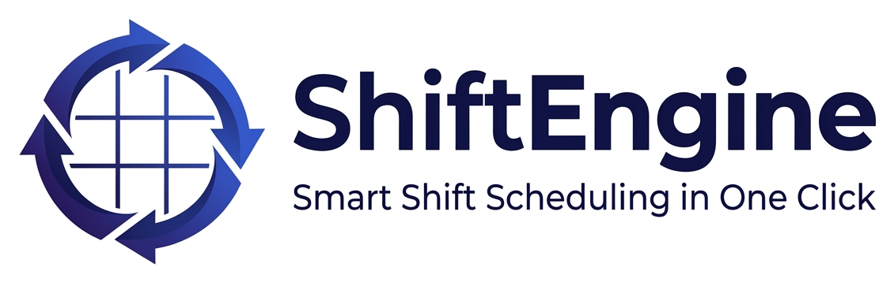
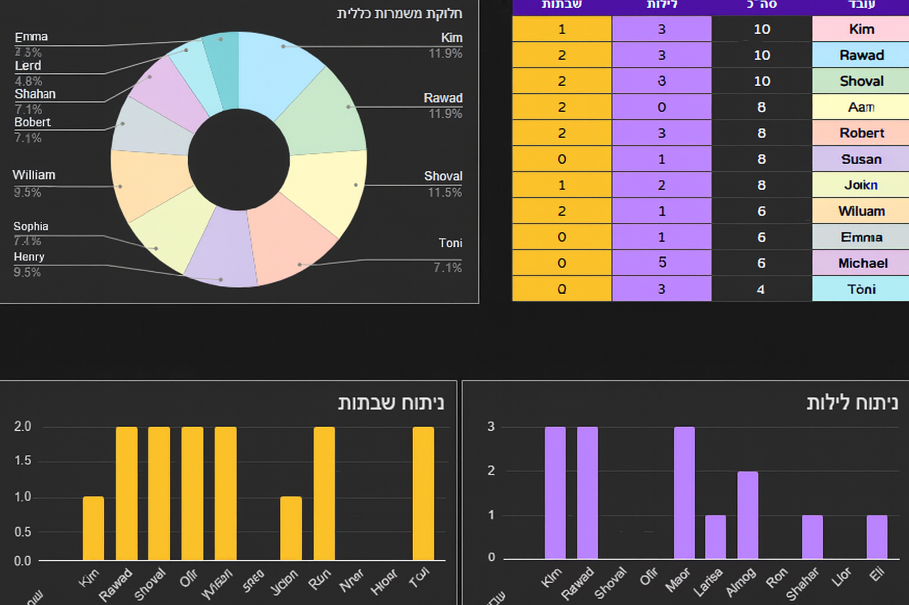
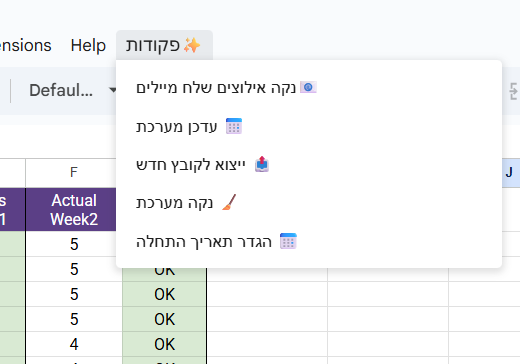
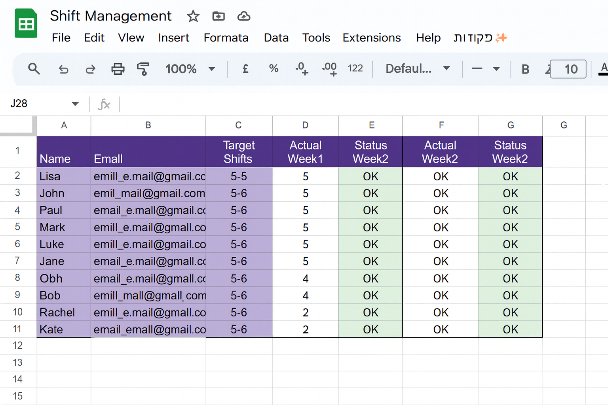
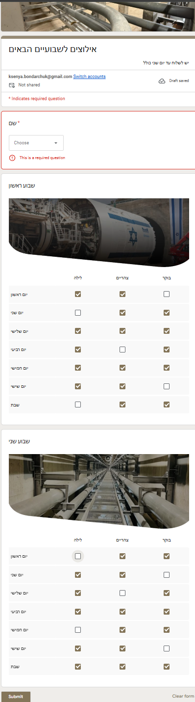
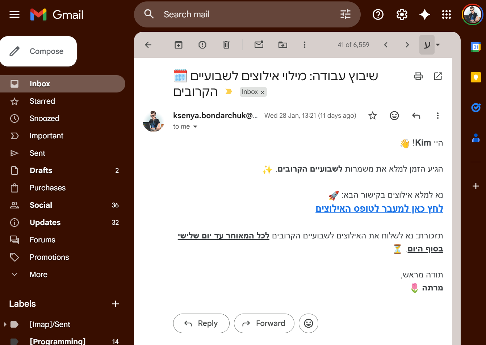
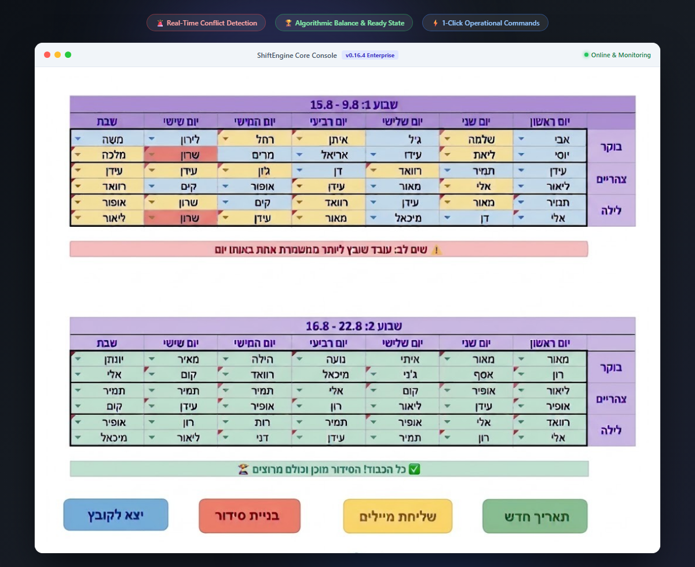
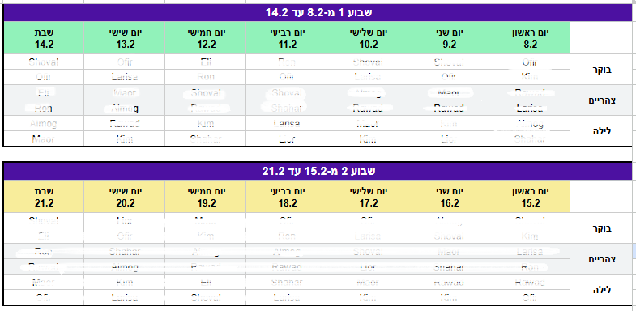
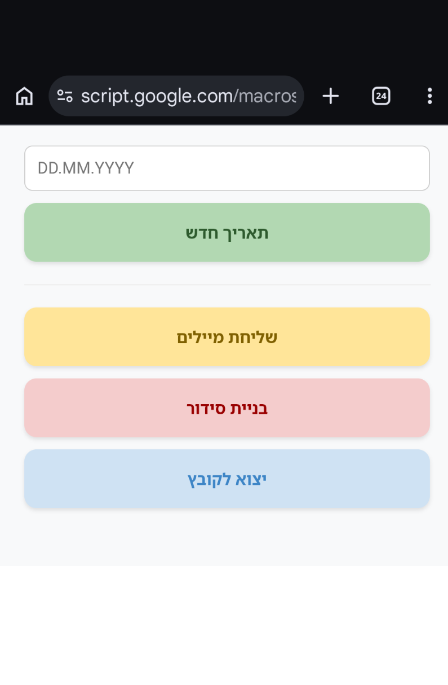
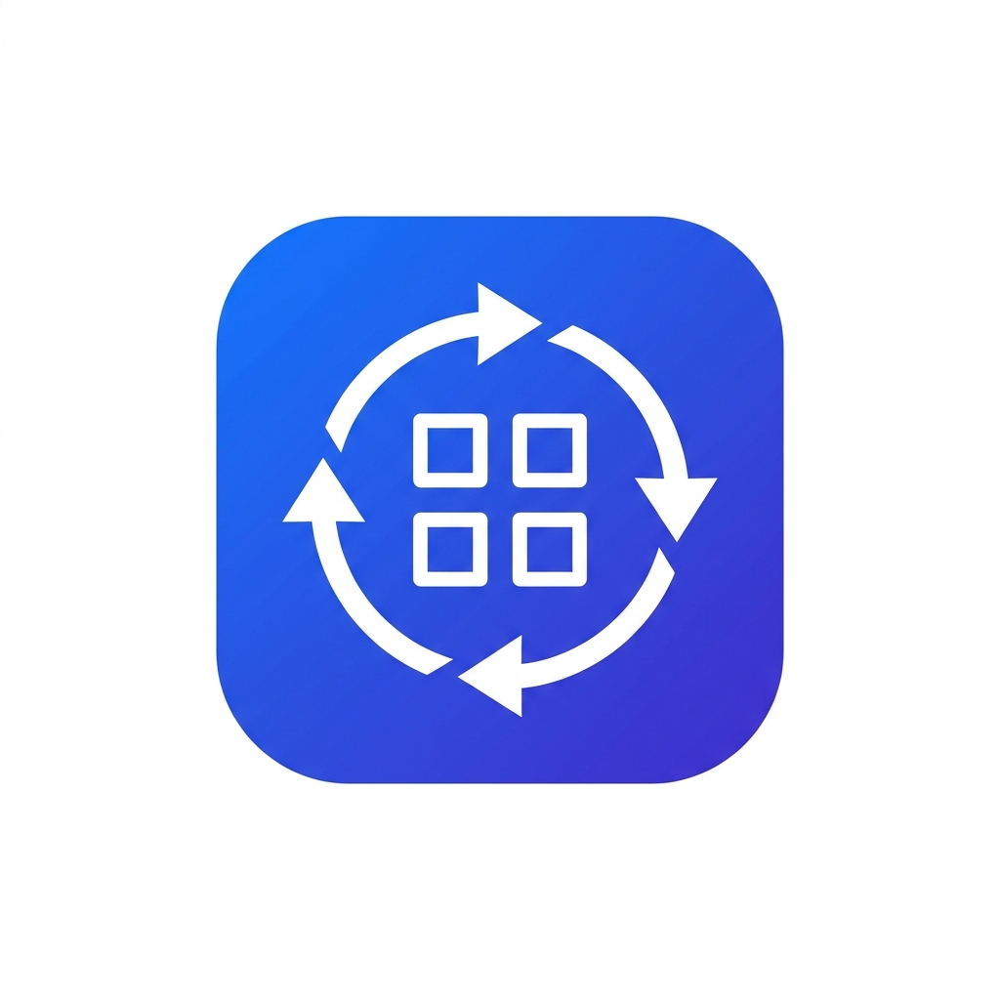

<p align="center">
  
</p>

<p align="center">
  <b>ShiftEngine — Smart Shift Scheduling in One Click</b>
</p>

<p align="center">
  One Click. Zero Conflicts. Perfectly Balanced Teams.
</p>

<p align="center">
  
  
  
  
</p>

<p align="center">
  ⭐ <i><b>Proven in Production:</b> Already powering operations across teams in a multi-national global enterprise.</i>
</p>

---

##  The Universal Scheduling Nightmare

Every team lead, operations manager, and dispatcher knows this weekly drain:
- ⏳ **Hours lost in spreadsheets**: Manually juggling overlapping requests, vacation days, and preferences across dozens of employees.
- 🤯 **Chaos across chat apps**: *"Hey, I forgot to submit"*, *"Can I work only Thursday evening?"*, *"Please swap me out!"*
- ❌ **Human fatigue & critical errors**: Someone accidentally scheduled for an early morning shift right after a late-night shift; another employee assigned 6 shifts instead of their agreed 4.
- 💥 **Team friction**: Suspicions of bias, arguments over who gets the weekend or night shifts, and burnt-out staff.

> **ShiftEngine** transforms this entire headache into an automated, error-free, and mathematically balanced workflow.

---

## ⚡ The ShiftEngine Pipeline: From Collection to Publication

ShiftEngine is a **commercial-ready, constraint-aware scheduling engine** designed for:

- 📞 Call Centers & Customer Support  
- 🛡 Security & Dispatch Units  
- 🏥 Medical & Emergency Teams  
- 🏢 Enterprise Operations  

It provides **automation, analytics, and real-time conflict detection**, transforming workforce management into a predictable, optimized process.

---

## 🧩 Core Features

- **Constraint-Based Assignment**  
  Prioritizes rare availability and balances workload targets.

- **Conflict Prevention Engine**  
  Detects and prevents double shifts, rest-time violations, and night-to-morning errors.

- **Dynamic Analytics Dashboard**  
  Real-time visualization of workloads, night shifts, and Shabbat distribution.

- **Automated Exports**  
  Generates visually distinct schedule files with unique color themes.

- **Dark Mode Friendly**  
  Optimized UI for both light and dark environments.

- **Google Workspace Integration**  
  Works directly with Forms & Sheets, using event triggers and Apps Script automation.

---

## 🏗 System Architecture

ShiftEngine consists of 4 logical layers:

1. **Data Ingress Layer** – Google Forms → Responses cleanup  
2. **Validation Engine** – Rule enforcement & conflict detection  
3. **Assignment Core** – Rare availability & target balancing  
4. **Analytics & Export Layer** – Dashboard & themed exports  

**Flow Diagram:**

Google Form
⬇
Responses Sheet
⬇
ShiftEngine Core
⬇
Validation Engine
⬇
Final Schedule + Analytics Dashboard
⬇
Dynamic Exports

---

## 📸 Product Interface

### Main Scheduling Grid


### Analytics Dashboard


### Integrated Command Center


### Staff Configuration


### Google Form Interface


---

## 🛠 Deployment & Setup

1. Clone this repository:
```bash
git clone https://github.com/TierK/ShiftEngine.git
```

---

## 🚀 Key Capabilities

### 1️⃣ One-Click Automated Email Dispatch (Smart Mailer)
Forget manual outreach and chasing people in Slack or Telegram:
* With a single click, the manager initiates a new scheduling cycle.
* ShiftEngine **automatically calculates the exact upcoming dates** for the 2-week period and generates personalized emails.
* Each team member receives an email addressed to them with the exact date range, a direct link to the submission form, and the deadline.
* Previous responses are safely archived — clean slate for the new rotation in seconds.

<p align="center">
  
</p>

---

### 2️⃣ Real-Time Response Tracker: Who Submitted & Who’s Pending
No need to open raw response sheets or manually cross-check names:
* The system **monitors incoming submissions in real time**.
* The live status bar keeps you updated at a glance: `📩 Waiting for responses: (7/15)`.
* Instant transparency on team compliance without lifting a finger.

<p align="center">
  
</p>

---

### 3️⃣ Instant Readiness Trigger: Know Exactly When to Build
No guesswork about whether everyone has submitted:
* The moment the final teammate submits their preferences, the dashboard flips to green: **`✅ All submissions received! Ready to generate`**.
* A clear, unmistakable trigger telling you it's time to run the algorithm.

---

### 4️⃣ Smart Algorithmic Auto-Scheduling
Click **"Update Schedule"**, and the constraint engine builds the roster in seconds:
* ⚖️ **Target Balance**: Strictly respects each employee's contracted weekly shifts/quota (e.g., 4 or 5 shifts/week).
* 🎯 **Scarcity-First Allocation**: Automatically locks in hard-to-fill shifts using team members with rare availability.
* 🛡️ **Zero Conflicts**: Enforces mandatory rest intervals and prevents double-booking.
* 🤝 **Fairness by Design**: Equitably distributes night shifts, weekends, and high-demand slots across the entire roster.

<p align="center">
  
</p>

---

### 5️⃣ Smart Manual Tweaks with Dynamic Candidate Dropdowns
Automation shouldn't tie your hands. Need to adjust a shift manually?
* Clicking any shift cell opens a **dynamic, context-aware dropdown list**.
* It reveals **ONLY employees who are actually available for that specific day and shift type** (Morning, Afternoon, Evening, or Night).
* No cross-referencing notes or guessing who can cover — eligible candidates are right at your cursor.

---

### 6️⃣ Real-Time Error Guardrails & Conflict Highlighting
Eliminate human error entirely. When making manual edits, ShiftEngine dynamically validates every change:
* 🚫 **Over-Quota Alert**: If an employee is assigned more shifts than their contracted target, their status immediately changes from `OK` to `Check`.
* 🚫 **Double-Shift Conflict**: Assigning someone twice on the same day instantly turns the cell **bright red** with an on-screen warning.
* 🚫 **Night ➔ Morning Violation (Rest Period Breach)**: Assigning an employee to a morning shift immediately after working the previous night (even across weekend transitions) triggers an instant red conflict flag.
* 🚫 **Unrecognized Name / Typo**: Any misspelled or non-staff name is immediately caught and highlighted.

---

### 7️⃣ Visual Distinction: Algorithm vs. Manual Changes
Total operational transparency at a glance:
* Shifts placed automatically by the algorithm carry a discrete marker and an informative tone.
* Cells manually adjusted by the supervisor are visually distinguished.
* You can immediately audit what was generated mathematically versus what was customized by hand.

---

### 8️⃣ "All Set!" Indication & One-Click Clean Export
Once all shifts are filled, targets are met, and zero conflicts remain:
* The entire schedule turns into a harmonious green success banner: **`✅ All checks passed! Schedule is balanced and ready 🏆`**.
* Click **"Export to New File"** to generate a clean, themed, standalone spreadsheet ready to share with the team, publish to PDF, or distribute to management.

<p align="center">
  
</p>

---

## 📊 Executive Analytics Dashboard (Dark Mode)

ShiftEngine includes a built-in executive intelligence dashboard:
* 📈 **Shift Type Breakdown**: Visual distribution of morning, evening, and night rotations.
* 🌙 **Night Shift Fairness**: Tracks night duty allocation per employee to prevent burnout.
* 🏖 **Weekend & Holiday Equity**: Ensures weekend coverage is shared fairly across the team.

<p align="center">
  
</p>

---

## 🥊 Comparison: Manual Chaos vs. ShiftEngine

| Criteria | Manual Spreadsheets & Chats | ShiftEngine Platform |
| :--- | :--- | :--- |
| **Availability Gathering** | Messy DMs, lost emails, endless reminders | Automated email dispatch + structured form |
| **Time to Final Schedule** | 3 – 6 hours of stressful puzzle-solving | **Under 3 minutes** (1-click algorithm + review) |
| **Conflict & Error Checking**| Eyeballed (easy to miss Night ➔ Morning) | **Real-time validation engine** with instant red alerts |
| **Manual Adjustments** | Scrolling through raw notes to find who's free | **Dynamic Dropdown** with pre-filtered candidates |
| **Workload Equity** | Staff resentment over perceived favoritism | **Mathematically balanced** target allocation |
| **Production Ready** | Manually re-checking every row and cell | **Instant Green "All OK" Indicator** + 1-Click Export |

---

## 📱 Executive Control from Any Device

Full scheduling control accessible from your desktop browser or Google Sheets mobile app:
- 🧹 *Reset & start a new cycle*
- 📧 *Dispatch availability emails to staff*
- 📅 *Generate optimal schedule via algorithm*
- 📤 *Export pristine schedule for publication*

<p align="center">
  
</p>

---

## 🏢 Enterprise Proven & Turnkey Integration

ShiftEngine’s core scheduling concepts are open for community review under the MIT license. 

Today, ShiftEngine is **actively powering workforce operations in a global enterprise**, managing complex shift rotations with zero downtime and high employee satisfaction.

For companies, dispatch units, 24/7 support teams, emergency services, and medical centers seeking a **ready-to-use, tailored deployment**, we provide full **Turnkey Setup & Commercial Licensing**:

### What’s Included in Turnkey Deployment:
1. 📦 **Complete Ready-to-Run Infrastructure**: Pre-configured Master Google Sheets, synchronized Google Forms, automated event triggers, and permission hardening installed directly into your corporate Google Workspace / Google Drive.
2. ⚙️ **Customized to Your Business Rules**:
   * Custom shift configurations (2/2, 3/3, 8h/12h/24h rotations, split shifts, custom rest periods).
   * Organization-specific target quotas, overtime rules, and weekend definitions.
   * Branded export files and customized staff email templates.
3. 🧑‍🏫 **Onboarding & Walkthrough**: Live training session for managers, operational playbook, and best practices.
4. 🛠 **Dedicated Support & Maintenance**: Priority updates, custom rule expansion, and ongoing support as your team scales.

> 💡 **Save your managers 15–30 hours of tedious admin work every single month.**

### 📩 Request a Live Demo & Implementation:
* ✉️ **Email:** [kimbfsd@gmail.com](mailto:kimbfsd@gmail.com)
* 💬 **GitHub:** [@TierK](https://github.com/TierK)
* 🤝 **Subject:** `ShiftEngine — Team Implementation & Demo Inquiry`

---

## 📄 License

The algorithmic core of this project is released under the [MIT License](LICENSE).  
Turnkey integration packages, enterprise master templates, and custom adaptation services are provided directly by the author.

<p align="center">
  
</p>

<p align="center">
  Built with 💜 by TierK
</p>
